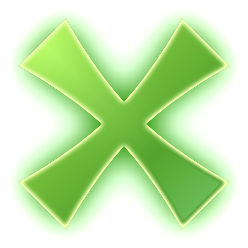

  

<h1 align="center">Sega Chihiro controls</h1>

  <strong>Each arcade game has its own cabinet, so each one gets its own DualSense layout.</strong>

---

## All games

| DualSense | Does |
|---|---|
| **Options** | Start |
| **D-pad Up** or **Create** | Insert a coin |
| **Touchpad** | XPSemu's quick menu |

> [!NOTE]
> These are for the standard layout. If you changed buttons in **Settings > Controller**, Chihiro games follow your layout too.

---

<strong>&nbsp; OutRun 2</strong>

 

| DualSense | Does |
|---|---|
| **Left stick** | Steer |
| **R2** | Gas |
| **L2** | Brake |
| **R1** | Gear up |
| **L1** | Gear down |
| **Triangle** | Change view |
| **Cross** | Start |

The steering wheel's force feedback comes through as rumble (Vibration on).

<strong>&nbsp; Crazy Taxi: High Roller</strong>

 

| DualSense | Does |
|---|---|
| **Left stick** | Steer |
| **R2** | Gas |
| **L2** | Brake |
| **R1** | Drive gear |
| **L1** | Reverse gear |
| **Square** | Jump |
| **Cross** | Start |

<strong>&nbsp; Ollie King</strong>

 

| DualSense | Does |
|---|---|
| **Left stick left / right** | Lean the board (turn) |
| **Left stick up** | Push the board's front |
| **Left stick down** | Push the board's back |
| **R1** | Right button |
| **L1** | Left button |
| **Cross** | Start |

<strong>&nbsp; Virtua Cop 3</strong> and <strong>Ghost Squad</strong> (gun games)

 

| DualSense | Does |
|---|---|
| **Left stick** | Move the crosshair |
| **R2** | Shoot |
| **L2** | Reload (points the gun off the screen) |
| **R1** | The gun's side button |
| **L1** | Change / pedal |
| **Cross** | Start |
| **Circle** | Ghost Squad only: insert or take back your card |

